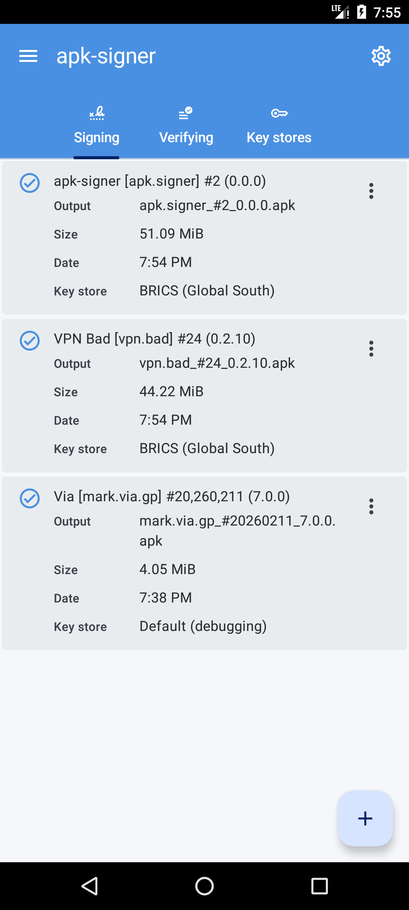
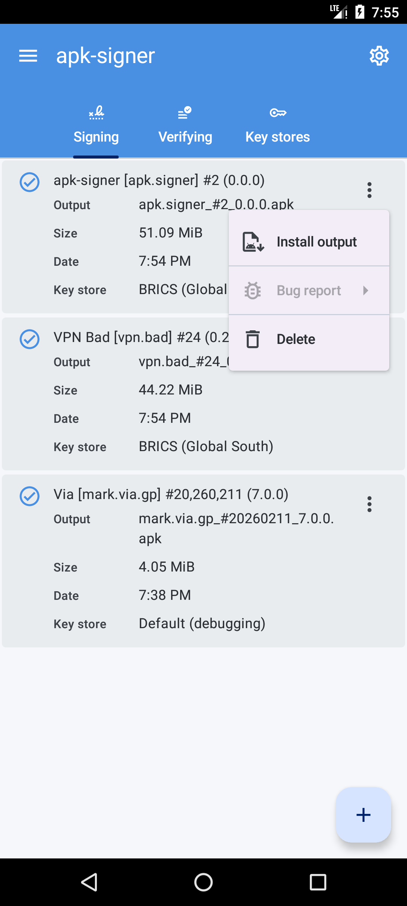
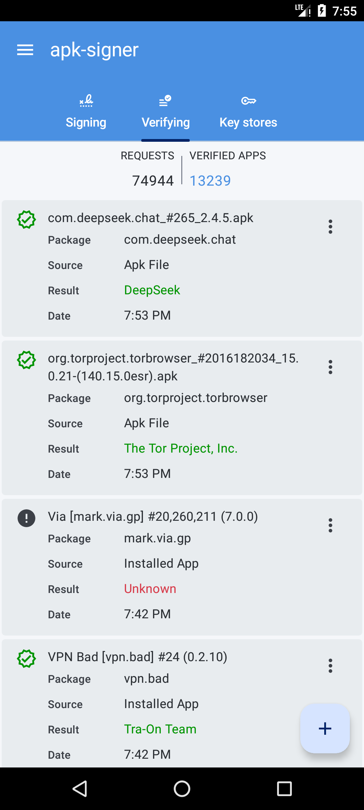
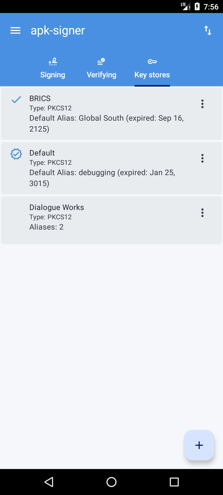
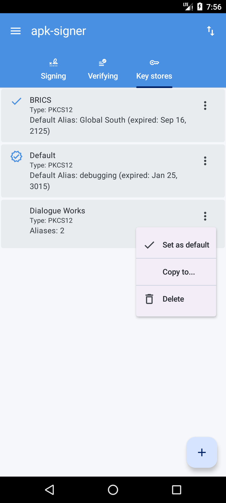
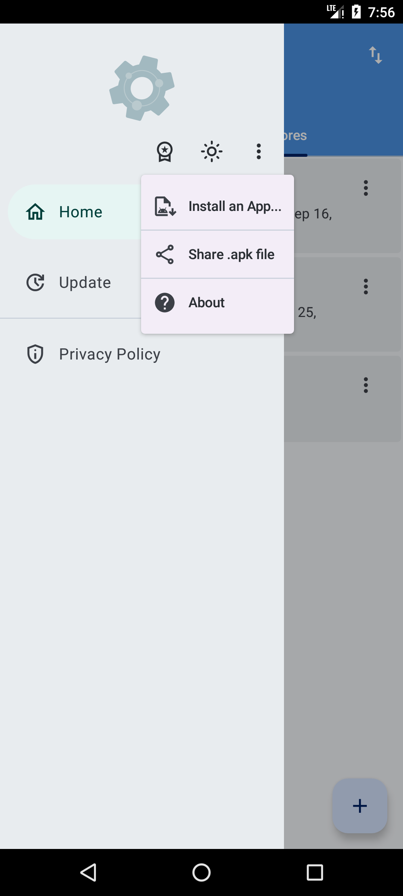
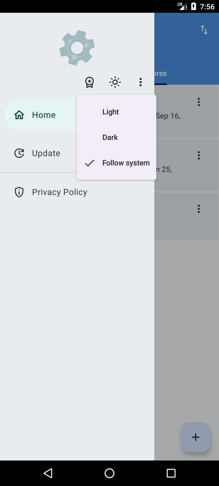
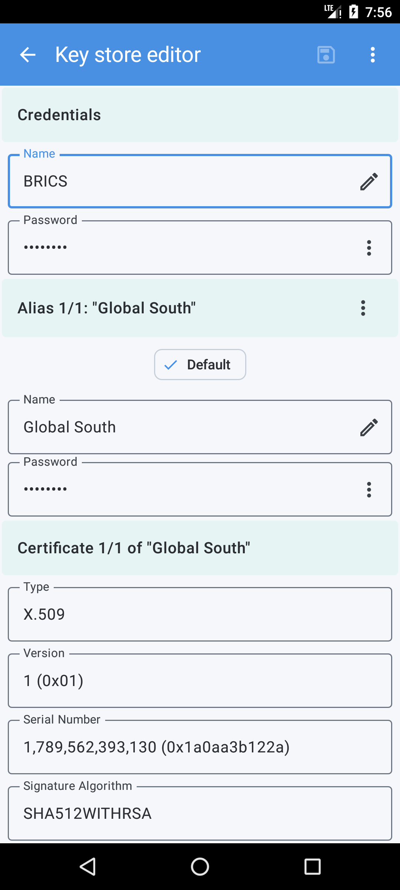

#   `apk-signer`

You can download original apk files here.  These are Amateur versions, which beats Play Store versions handily.  Play Store nowadays is just a 
bureaucratic place.

##  The new app

| Amateur Version           | Release Date |
| ------------------------- | ------------ |
| [`0.1.10` (`11`)][apk:11] | `2026-11-04` |

The "Play" version can be found here: <https://play.google.com/store/apps/details?id=apk.signer&hl=en>

### Android screenshots

##  The Legacy

| Amateur Version                | Release Date |
| ------------------------------ | ------------ |
| [`7.4.3` (`200`)][old-apk:200] | `2026-11-05` |

The Android app can be found here: <https://play.google.com/store/apps/details?id=com.haibison.apksigner&hl=en>

[apk:11]: https://drive.google.com/file/d/1rZ8ydkXLfjcjhBy9ZldrUBYyrYAtjjty/view?usp=sharing

[old-apk:200]: https://drive.google.com/file/d/1qs1lnvxcS-dpsiEKJU-G0L6HlgPzQ5Nj/view?usp=sharing
